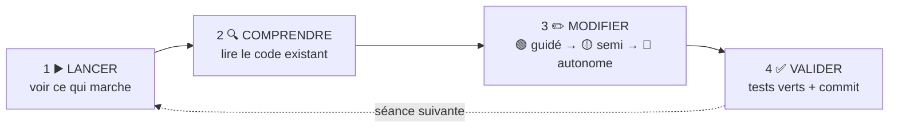

# 🗺️ Parcours Centre de supervision NIS 2 · DORA — 8 séances de 2 heures

> Suivez les séances **dans l'ordre**, cochez [PROGRESSION.md](PROGRESSION.md) au fur et à mesure,
> et committez souvent.

---

## 🧭 Six repères, partout dans le dépôt

| Repère | Ce qu'il veut dire | Où vous le trouvez | Quand |
|---|---|---|---|
| 📖 **Lire** | s'informer : il n'y a **rien à produire** | fiches de [cours/](cours/README.md), message du jour, [cahier des charges](docs/cahier-des-charges.md), code existant | avant et au début de la séance |
| ✏️ **Faire** | produire une **trace** que l'enseignant peut vérifier | les missions (code + tests), [`CARNET.md`](CARNET.md), les commits, [`PROGRESSION.md`](PROGRESSION.md), le journal | pendant la séance |
| 🧠 **Retenir** | ce qui sera **interrogé sans machine** | la fin de chaque guide, les fiches de cours | à revoir avant chaque contrôle d'entrée |
| 🎯 **Pourquoi** | à quoi sert la séance, pour le centre de supervision **et** pour votre métier | en tête de chaque guide | à l'oral E5 : c'est ce que vous expliquerez |
| ⚖️ **Le droit** | l'obligation de NIS 2, de DORA ou du contrat derrière la séance, et la règle qui la traduit | l'encart ⚖️ de chaque feuille de route, [le droit de la supervision](docs/cadre-juridique.md) | en séance ; toute la fiche avant l'interrogation n° 2 |
| 📂 **Support** | un écrit à produire (ANSSI, client, direction), à partir de vos écrans | [les documents de la supervision](docs/documents-a-produire.md), trames dans [`CARNET.md`](CARNET.md) | séances 7 et 8 |

**Chaque guide de séance commence par sa feuille de route** : ces repères, la liste des missions, le fichier à
modifier pour chacune et la preuve attendue. Lisez-la en premier : en deux minutes, vous savez ce qui vous attend.

### Qui sert à quoi

| Document | Vous en faites quoi ? |
|---|---|
| [README](README.md) | 📖 la situation, une fois au départ ; démarrer l'environnement |
| [Vidéo de présentation](docs/video/README.md) | 📖 le contexte en quelques minutes, avant la séance 1 |
| **[seances/](seances/)** | ✏️ **le guide que l'on suit** pendant la séance, de haut en bas |
| [cours/](cours/README.md) | 📖 lire avant la séance · 🧠 refaire l'auto-évaluation avant une interrogation |
| [docs/cahier-des-charges.md](docs/cahier-des-charges.md) | 📖 la référence : vocabulaire, règles RG1 à RG10, services, composants, notifications |
| [docs/cadre-juridique.md](docs/cadre-juridique.md) | 📖 ⚖️ le droit : NIS 2, DORA, RGPD, contrat et preuve |
| [docs/documents-a-produire.md](docs/documents-a-produire.md) | 📖 📂 le dossier de la supervision, et les quatre supports que vous rédigez |
| [CARNET.md](CARNET.md) | ✏️ vos réponses écrites et vos supports, séance par séance |
| [PROGRESSION.md](PROGRESSION.md) | ✏️ vos cases à cocher |
| [DEPANNAGE.md](DEPANNAGE.md) | en cas d'erreur : cherchez le message |
| [e5/](e5/FICHE-REALISATION.md) | ✏️ la fiche de réalisation, en séance 8 |

### Avant, pendant, après une séance

| Moment | 📖 Lire | ✏️ Faire | 🧠 Retenir |
|---|---|---|---|
| **Avant** (15 min, à la maison) | la fiche de cours de la séance | son auto-évaluation | — |
| **Pendant** (2 h) | la feuille de route, la situation, le code existant | 2 · Comprendre dans le carnet ; les missions 🟢 puis 🟡 ; commit | les notions au débriefing |
| **Après** (si besoin) | — | finir la mission 🟡 commencée ; le journal au portail | relire *À retenir* : c'est le contrôle d'entrée suivant |

## 🔁 La méthode : quatre temps, à chaque séance

Vous ne partez jamais d'une page blanche : l'application tourne, vous la comprenez, puis vous la faites évoluer.

| Palier | Ce qu'on vous donne | Tests |
|---|---|---|
| 🟢 **Guidé** | L'objectif, la démarche pas à pas, le code clé | groupe `seance-NN` |
| 🟡 **Semi-guidé** | L'objectif, les grandes étapes, un indice | groupe `seance-NN` |
| 🔴 **Autonome** | L'objectif et le critère de réussite | groupe `bonus` (facultatif) |

Les solutions complètes ne sont pas dans le dépôt : chercher fait partie du métier.
Bloqué plus de 10 minutes ? Relisez l'indice, puis [DEPANNAGE.md](DEPANNAGE.md), puis ouvrez une *issue* (modèle
« Question » fourni) ou levez la main.

## ⏱️ Le déroulé d'une séance

| Durée | Temps | Ce que vous faites |
|---|---|---|
| 10 min | **Contrôle d'entrée** | 5 questions au portail sur les notions de la séance précédente |
| 10 min | **Situation** | Le message du jour, lu ensemble ; on lance l'exercice |
| 80 min | **Missions** | 🟢 puis 🟡 ; 🔴 si vous avez fini |
| 10 min | **Valider** | `php artisan test --group=seance-NN`, commit, push |
| 10 min | **Débriefing** | Les notions de la séance, puis votre **journal de fin de séance** |

Le journal tient en trois lignes, dans le portail : *ce que j'ai fait · ce qui m'a bloqué · ce que j'ai compris
aujourd'hui*. Il compte dans l'évaluation de votre engagement.

## 🗺️ Les 8 séances

| # | Séance | 🎯 La demande | ✏️ Ce que vous livrez | 🧠 Ce que vous apprenez | Guide |
|---|---|---|---|---|---|
| 1 | **Moniteur 1 : les services et leur GTR** | « La passerelle de paiement est restée coupée deux heures » | l'ordre de rétablissement (RG2), la consommation de la GTR (RG1) | règle de gestion isolée, tri à plusieurs clés, MVC | [▶️](seances/seance-01.md) |
| 2 | **Dépendances et historique** | « Qui dépend de quoi ? On ne perd rien » | l'association service–composant, données reprises ; l'historique des états | association porteuse, migration, reprise | [▶️](seances/seance-02.md) |
| 3 | **Moniteur 2 : le journal d'incident** | « On ne réécrit pas le journal » | le journal horodaté et immuable (RG4) | Form Request, CSRF, immuabilité | [▶️](seances/seance-03.md) |
| 4 | **Incident important et notifications** | « Fallait-il prévenir l'ANSSI, avant quand ? » | les critères NIS 2 (RG5) ; les horloges, dans l'ordre, une seule fois (RG6) | règle réglementaire, exception métier, 409, transaction, verrou | [▶️](seances/seance-04.md) |
| 5 | **Les quatre moniteurs synchronisés** | « Les écrans clignotent et ma saisie s'efface » | une API d'état, des moniteurs qui écoutent, une sélection partagée (RG7) | API, ETag et 304, BroadcastChannel | [▶️](seances/seance-05.md) |
| 6 | **Sécurité et rôles** | « N'importe qui peut notifier l'ANSSI ! » | connexion, rôles et portefeuilles (RG8), signature | hachage, autorisation, Gate | [▶️](seances/seance-06.md) |
| 7 | **Moniteur 4 : tiers, clients DORA, registre** | « Nos clients financiers nous demandent de quoi classifier » | prestataires, aide à la classification DORA (RG9), registre et concentration (RG10), indicateurs ; 📂 alerte précoce, information d'un client | historique, seuils, indicateurs | [▶️](seances/seance-07.md) |
| 8 | **L'exercice** | « Mardi, on joue l'exercice devant l'auditeur » | la faille corrigée (signature HMAC), vos tests, la recette, le retour d'expérience, la fiche E5 ; 📂 rapport final, rapport d'exercice | contrôle d'accès, intégrité, tests, exploitation, RETEX | [▶️](seances/seance-08.md) |

### ⚖️ Le droit, séance par séance

| # | L'obligation | Le texte | Dans l'application |
|---|---|---|---|
| 1 | tenir la GTR promise ; la criticité 1 = une fonction critique ou importante du client | contrat ; DORA | GTR (RG1), ordre de rétablissement (RG2) |
| 2 | connaître ses dépendances et ses fournisseurs (chaîne d'approvisionnement) | NIS 2, art. 21.2 d | association service–composant (RG3) |
| 3 | un écrit électronique prouve s'il est intègre et son auteur identifié | code civil, art. 1366 | journal immuable (RG4) |
| 4 | qualifier l'incident ; alerte 24 h, notification 72 h, rapport final 1 mois ; délais des contrats | NIS 2, art. 23 ; règlement 2024/2690 ; DORA, art. 30 | critères (RG5), horloges (RG6) |
| 5 | tous voient la même échéance au même moment | — | moniteurs synchronisés (RG7) |
| 6 | la direction approuve et répond des mesures ; imputabilité | NIS 2, art. 20 ; code civil, art. 1366 | rôles, portefeuilles, signature (RG8) |
| 7 | le client financier classe et notifie l'ACPR ; registre, concentration | DORA, art. 18, 19, 28-30 ; règlement 2024/1772 | aide à la classification (RG9), registre (RG10) · 📂 alerte précoce, information de PilatPay |
| 8 | évaluer l'efficacité des mesures ; cause profonde au rapport final | NIS 2, art. 21.2 f et 23.4 d | audit, signature, RETEX · 📂 rapport final, rapport d'exercice |

Deux **interrogations écrites** de 30 minutes, sur papier, ouvrent les séances 5 et 8. Elles portent sur ce que vous
avez codé : écrire une ligne de PHP, choisir et justifier un code HTTP, prévoir ce qu'affiche un moniteur, repérer et
corriger une erreur. Pas de QCM.

## 📦 Ce qui prouve votre travail

| Preuve | Où |
|---|---|
| Les tests de chaque séance au vert | onglet **Actions** de votre dépôt (une ligne par séance) |
| Des commits réguliers et lisibles | `feat: ordre de reprise (RG2)`, `fix: export protégé`… |
| `PROGRESSION.md` à jour | à la racine, committé |
| Vos réponses écrites | [`CARNET.md`](CARNET.md), committé à chaque séance |
| Le journal de fin de séance | portail |
| Les quatre supports | [`CARNET.md`](CARNET.md), séances 7 et 8 : alerte précoce à l'ANSSI, information de PilatPay, projet de rapport final, rapport d'exercice |
| La fiche de réalisation E5 | [e5/FICHE-REALISATION.md](e5/FICHE-REALISATION.md), complétée en séance 8 |

## 🏆 Ce que vous saurez faire à la fin

- Reprendre une application existante, la lire et la faire évoluer sans la casser
- Traduire des règles de gestion et des **textes réglementaires** (NIS 2, DORA) en code exact, et les prouver par des tests
- Faire évoluer une base en service : migrations, reprise de données, historique
- Garantir l'intégrité d'une donnée : immuabilité, transaction, verrou, signature
- Faire dialoguer des pages et un serveur sans gaspiller, et faire communiquer plusieurs écrans
- Protéger une application : connexion, rôles, signature, contrôle d'accès, intégrité des données reçues
- Préparer une application pour l'exploitation, la recetter, et la présenter dans votre dossier E5
- Expliquer ce qu'imposent NIS 2 et DORA quand un incident survient, et rédiger les écrits qu'ils exigent
