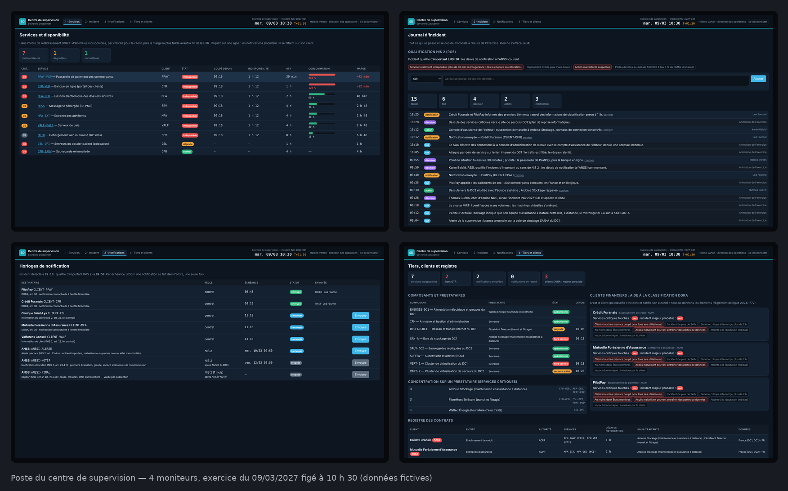

# 📡 Centre de supervision NIS 2 · DORA — Situation professionnelle Laravel · BTS SIO SLAM

<div align="center">

**[🎬 Vidéo de présentation](docs/video/README.md)** · **[🗺️ Parcours](PARCOURS.md)** · **[📋 Ma progression](PROGRESSION.md)** · **[📝 Mon carnet](CARNET.md)** · **[🎓 Fiches de cours](cours/README.md)** · **[📐 Cahier des charges](docs/cahier-des-charges.md)** · **[⚖️ Le droit](docs/cadre-juridique.md)** · **[📂 Documents](docs/documents-a-produire.md)** · **[🚑 Dépannage](DEPANNAGE.md)**

</div>

---

## 🎯 La situation

**Sevranne Datacenter** — un infogéreur-hébergeur de la Loire, deux centres de données, 180 salariés, 140 clients —
fait tourner la banque en ligne d'une banque, la passerelle de paiement d'un établissement de paiement, la gestion des
sinistres d'une mutuelle, les serveurs d'une clinique. Au sens de la directive **NIS 2**, c'est une **entité
importante** : chaque incident important doit être notifié à l'ANSSI dans des délais stricts. Et ses trois clients
financiers sont soumis au règlement **DORA** : ils doivent eux-mêmes classer chaque incident et prévenir l'ACPR en
moins de 24 heures — avec les informations que Sevranne leur donne.

Le 9 mars 2027, une mise à jour installée à distance par l'éditeur de la baie de stockage fait tomber sept services ;
une heure plus tard, on découvre que l'outil d'assistance de l'éditeur a été piraté. Ce jour-là, personne n'a su dire
s'il fallait prévenir l'ANSSI, ni avant quand ; PilatPay a appris la panne en appelant lui-même.

Un développeur a commencé un outil de supervision, puis il est parti. La directrice des opérations, **Hélène Vartan**,
vous confie la suite, pour l'**exercice du mardi 9 mars 2027** : on rejoue l'incident, et cette fois, aucun délai ne
doit passer sans que personne ne le voie.



*L'application terminée, à 10 h 30 de l'exercice — détail des écrans dans [docs/maquettes](docs/maquettes/README.md).*

Le poste a **quatre moniteurs** : pendant un incident, il faut voir *en même temps* ce qui est coupé, ce qui se passe,
qui prévenir avant quand, et qui d'autre est touché. Des onglets en cacheraient trois sur quatre.

| Moniteur | La question à laquelle il répond |
|---|---|
| **1 · Services et disponibilité** | Quels services sont coupés, pour quels clients, et combien de temps reste-t-il avant la fin de la GTR ? |
| **2 · Incident et qualification** | Que s'est-il passé, et l'incident est-il « important » au sens de NIS 2 ? |
| **3 · Horloges de notification** | Qui prévenir — ANSSI, clients — et avant quand ? |
| **4 · Tiers, clients et registre** | De quels prestataires dépend-on, et quels clients financiers sont touchés (DORA) ? |

| Ce qui existe le premier jour | Ce que vous aurez livré en huit séances |
|---|---|
| Moniteur 1 : les services dans le désordre, des durées en minutes | L'ordre de rétablissement (RG2), la consommation de la GTR (RG1) |
| Les dépendances notées en texte (« VIRT-1;SAN-A ») | Une vraie association, bloquante ou redondante, données reprises ; l'historique des états |
| — | Moniteur 2 : le journal d'incident, que personne ne peut réécrire (RG4) ; les critères NIS 2 (RG5) |
| — | Moniteur 3 : les horloges ANSSI et clients, dans l'ordre, une seule fois (RG6) |
| Des pages qui se rechargent toutes les 5 secondes | Quatre moniteurs synchronisés, une sélection partagée (RG7) |
| N'importe qui « notifie l'ANSSI » | Connexion, rôles et portefeuilles, signature (RG8) |
| — | Moniteur 4 : prestataires, aide à la classification DORA (RG9), registre et concentration (RG10) |
| Une porte laissée ouverte par le développeur… | Un audit, une signature HMAC, vos tests, la recette, le retour d'expérience |
| Des délais légaux que personne ne surveille | Quatre écrits : alerte précoce à l'ANSSI, information d'un client financier, projet de rapport final, rapport d'exercice |

> Toutes les personnes, organisations, données et événements de ce dépôt sont **fictifs** ; les textes juridiques cités sont réels.

## 🚀 Démarrer en 5 minutes

1. En haut de ce dépôt : **Use this template → Create a new repository**, nommé `supervision-NOM-Prenom` (privé).
2. Dans **votre** dépôt : **Code → Codespaces → Create codespace on main**.
3. Attendez le message `✅ Le centre de supervision est prêt.` dans le terminal (3 à 5 minutes la première fois :
   trois conteneurs démarrent — Apache + PHP, MySQL, phpMyAdmin). Si VS Code demande « Faites-vous confiance aux
   auteurs… ? », répondez **Approuver**.
4. Démarrez l'exercice : **Ctrl+Maj+B**, ou dans le terminal :

   ```bash
   ./lancer.sh
   ```

   Ctrl+clic sur l'adresse affichée : l'horloge en haut à droite avance, l'exercice se déroule vingt fois plus vite
   que la réalité.
5. Dans le terminal :

   ```bash
   cd projetLaravel
   php artisan test --group=socle      # 9 tests verts : tout fonctionne
   ```

## 🧭 Ce que l'on attend de vous

Tout le dépôt utilise six repères :

| | | Concrètement |
|---|---|---|
| 📖 | **Lire** — rien à produire | la fiche de cours avant la séance ; le message du jour ; le code existant |
| ✏️ | **Faire** — une trace à laisser | le code des missions (les tests le vérifient), vos réponses dans [`CARNET.md`](CARNET.md), un commit |
| 🧠 | **Retenir** — sans la machine | cinq notions par séance, interrogées au contrôle d'entrée suivant |
| 🎯 | **Pourquoi** | ce que la séance apporte au centre de supervision, et à votre métier |
| ⚖️ | **Le droit** | l'obligation de NIS 2, de DORA ou du contrat derrière la séance, et la règle qui la traduit |
| 📂 | **Support** | un écrit à produire, à partir de vos écrans (séances 7 et 8) |

**À chaque séance, un seul fichier à suivre :** `seances/seance-NN.md`. Il commence par sa **feuille de route**
(quoi lire, quoi faire et où, quoi retenir), puis vous guide pas à pas. Le [Parcours](PARCOURS.md) montre les huit
séances d'un coup d'œil.

Pour commencer : regardez la **[vidéo de présentation](docs/video/README.md)**, lisez [📂 les documents de la
supervision](docs/documents-a-produire.md) et les § 1-2 du [⚖️ droit](docs/cadre-juridique.md), puis ouvrez la [séance 1](seances/seance-01.md).

## ⚖️ NIS 2, DORA : les délais qui courent pendant l'incident

| Qui | Obligation | Texte | Point de départ | Échéance à l'exercice | Où |
|---|---|---|---|---|---|
| Sevranne | alerter chaque client dans le délai du contrat | contrats (DORA, art. 30) | détection, 09:18 | PilatPay **09:48**, Crédit Furanais 10:18… | moniteur 3 |
| Sevranne | **alerte précoce** à l'ANSSI | NIS 2, art. 23.4 a | qualification d'incident important, 09:50 | **mer. 10/03 09:50** (24 h) | moniteur 3 |
| Sevranne | **notification d'incident** à l'ANSSI | NIS 2, art. 23.4 b | qualification, 09:50 | **ven. 12/03 09:50** (72 h) | moniteur 3 |
| Sevranne | **rapport final** à l'ANSSI, validé par la direction | NIS 2, art. 23.4 d et 20 | envoi de la notification | un mois après | moniteur 3 |
| chaque client financier | **classer** l'incident ; s'il est majeur, le notifier à l'ACPR | DORA, art. 18-19 ; règlements 2024/1772 et 2025/301 | sa prise de connaissance | 4 h après la classification, au plus tard **24 h** | moniteur 4 (aide) |

À lire : **[⚖️ le droit de la supervision : NIS 2 et DORA](docs/cadre-juridique.md)** et **[📂 les documents de la
supervision](docs/documents-a-produire.md)** — dont les quatre supports que vous rédigerez.

## 🧪 Les tests sont votre cahier des charges

Chaque séance a son groupe de tests. Au départ ils sont **rouges** : ils décrivent ce que vous allez construire. Une
mission est terminée quand ses tests passent au vert.

```bash
cd projetLaravel
php artisan test --group=socle            # doit TOUJOURS rester vert
php artisan test --group=seance-01        # les tests de la séance 1
php artisan test --filter=test_m2 --group=seance-01   # une seule mission
php artisan test --group=bonus            # les missions 🔴, facultatives
php artisan test                          # tout
```

À chaque `git push`, GitHub rejoue les tests sur MySQL : l'onglet **Actions** montre une ligne par séance, et une
ligne pour le style du code.

## 📁 Le dépôt

```
supervision/
├── README.md                vous êtes ici
├── PARCOURS.md              la méthode et les 8 séances, dans l'ordre
├── PROGRESSION.md           vos cases à cocher (à committer)
├── CARNET.md                vos réponses écrites et vos supports, séance par séance (à committer)
├── DEPANNAGE.md             erreurs fréquentes, classées par message
├── lancer.sh                ▶ démarre l'exercice (./lancer.sh, recette, adresses)
├── seances/                 un guide par séance (2 h)
├── cours/                   fiches de cours + auto-évaluations
├── docs/                    cahier des charges (RG1 à RG10), le droit (NIS 2, DORA), les documents, maquettes, vidéo
├── e5/                      fiche de réalisation pour votre tableau de synthèse E5
└── projetLaravel/           ⬅ l'application (Laravel 13, PHP 8.4, MySQL 8.4)
    ├── app/Exercice/        fourni : l'horloge et le moteur qui rejoue le scénario
    ├── app/Regles/          les règles de gestion (squelettes à écrire)
    ├── app/Http/Controllers/  app/Models/  resources/views/  routes/
    ├── database/data/       Sevranne (référentiel : composants, services, contrats) et le scénario de l'exercice
    └── tests/Feature/       Socle/ · Seance01/ … Seance08/ · Bonus/ · Etudiant/ (les vôtres)
```

## 🛠️ Environnement

| Élément | Rôle |
|---|---|
| Apache + PHP 8.4 | sert l'application en permanence sur le port **8000** |
| MySQL 8.4 | la base `supervision` ; phpMyAdmin sur le port **8080** |
| `./lancer.sh` | remet la base à neuf et relance l'exercice à 09:00 ; `./lancer.sh recette` le fige à 10:00 |
| Le moteur d'exercice | rejoue l'incident du 9 mars (09:00-13:00, 18 injects), 20 fois plus vite |

---

*Projet pédagogique — BTS SIO option SLAM, 2026-2027. L'entreprise, ses clients, ses personnes et l'incident sont fictifs.*
