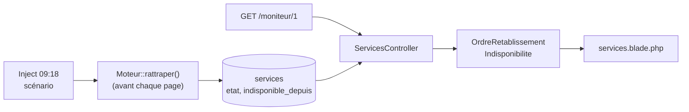

# Supervision, GTR et MVC Laravel

> **Séance 1** · Lecture 8 min · ▶️ [Faire la séance](../seances/seance-01.md)

## L'idée

Un infogéreur rend des **services** à ses clients — une banque en ligne, une passerelle de paiement — et promet, dans
chaque contrat, une **GTR** : une durée maximale d'interruption. Quand plusieurs services tombent ensemble, le centre de
supervision doit savoir **par quoi commencer** : d'abord ce qui est coupé, parmi ce qui est coupé ce qui compte le plus
pour le client (la criticité), et parmi ceux-là ce qui va dépasser sa garantie le plus tôt (la marge).

| Service | Criticité | GTR | Coupé depuis | À 10:00 | Marge |
|---|---|---|---|---|---|
| Passerelle de paiement | 1 | 30 min | 09:18 | 42 min = 140 % | −12 min |
| Banque en ligne | 1 | 1 h | 09:18 | 42 min = 70 % | 18 min |
| Hébergement mutualisé | 3 | 8 h | 09:18 | 42 min = 9 % | 7 h 18 |

Laravel organise le code en **MVC** : la **route** associe une adresse à une méthode de **contrôleur** ; le contrôleur
prépare les données (le **modèle** Eloquent les lit en base) ; la **vue** Blade les affiche. Une **règle de gestion**
(trier, calculer une consommation) ne va ni dans la vue ni dans la route : dans une classe à part (`app/Regles`), qui
reçoit tout ce qu'il lui faut, y compris l'heure — on la teste alors seule, à n'importe quelle heure.



## Le code à reconnaître

```php
Route::get('/moniteur/1', [ServicesController::class, 'index'])->name('moniteur.services');
```
```php
return collect($services)->sortBy([
    fn ($a, $b) => $a->criticite <=> $b->criticite,          // d'abord la criticité…
    fn ($a, $b) => $a->code <=> $b->code,                    // …puis, à égalité, le code
])->values();
```
```blade
<tr data-service="{{ $s->code }}" data-niveau="{{ $niveau }}">
    <td class="mono">{{ \App\Support\Duree::format($s->gtr_minutes) }}</td>
```

## Les pièges

- **Trier deux fois de suite** (`sortBy(...)->sortBy(...)`) : le second tri défait le premier. Un seul `sortBy([...])`.
- **Appeler `now()` dans une règle** : l'heure de l'ordinateur n'est pas celle de l'exercice, et la règle ne se teste plus.
- **`>=` au lieu de `>`** : à 100 % pile, la GTR n'est pas encore dépassée.
- **Diviser pour un service qui fonctionne** : il n'a pas de durée d'indisponibilité ; la consommation est `null`.

## ✅ Auto-évaluation

1. Qu'est-ce qu'une GTR, et qui la fixe ?
2. Un service de GTR 2 h est coupé depuis 09:18. À 10:48, quel est son niveau ? Sa marge ?
3. Pourquoi une règle de gestion reçoit-elle l'heure en paramètre ?
4. Deux services coupés, criticité 1, même marge : qui passe d'abord ?
5. Que fait une route ? un contrôleur ? une vue ?

<details><summary>Réponses</summary>

1. La garantie de temps de rétablissement : la durée maximale d'interruption promise au client, fixée par le contrat.
2. 90 min sur 120 = 75 % : « risque » ; marge 30 min.
3. Pour qu'elle calcule à l'heure de l'exercice, et qu'on puisse la tester à n'importe quelle heure.
4. Celui dont le code vient en premier dans l'ordre alphabétique (dernière clé de tri).
5. La route associe une URL et un verbe à une méthode ; le contrôleur prépare les données ; la vue les affiche.
</details>
