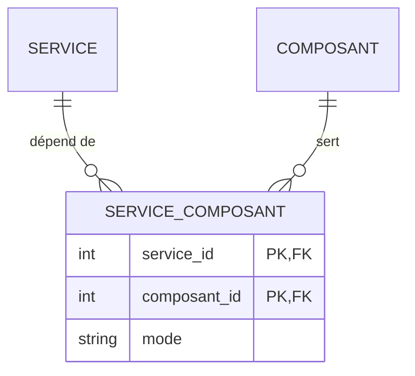

# Association porteuse et reprise de données

> **Séance 2** · Lecture 10 min · ▶️ [Faire la séance](../seances/seance-02.md)

## L'idée

Un service dépend de plusieurs composants, et un composant sert plusieurs services : c'est une association
plusieurs-à-plusieurs. Elle porte une information — le **mode** : sans ce composant, le service s'arrête-t-il
(**bloquant**) ou se dégrade-t-il seulement (**redondant**) ? Au niveau physique, une association porteuse devient une
**table** dont la clé est le couple des deux identifiants, plus la donnée portée.



La base est **en service** : les dépendances notées en texte (« VIRT-1;SAN-A ») doivent passer dans la nouvelle table
**sans perte**. Une migration de reprise travaille toujours dans cet ordre : **ajouter** la structure, **transférer**
les données, **supprimer** l'ancien. Et l'on lance `php artisan migrate`, jamais `migrate:fresh`, qui efface tout.

Pour savoir combien de temps un service a été coupé, il faut garder chaque changement d'état au lieu de l'écraser :
c'est un **historique**.

## Le code à reconnaître

```php
// 2. Le transfert, dans la migration (DB:: et non les modèles)
$composants = DB::table('composants')->pluck('id', 'code');
foreach (DB::table('services')->get(['id', 'composants']) as $service) {
    foreach (array_filter(array_map('trim', explode(';', (string) $service->composants))) as $code) {
        if (isset($composants[$code])) {
            DB::table('service_composant')->insert(['service_id' => $service->id, 'composant_id' => $composants[$code], 'mode' => 'bloquant']);
        }
    }
}
```
```php
public function composants(): BelongsToMany
{
    return $this->belongsToMany(Composant::class, 'service_composant')->withPivot('mode');
}
// $service->composants->first()->pivot->mode
```

## Les pièges

- **Supprimer la colonne avant le transfert** : les dépendances sont perdues, définitivement.
- **Utiliser les modèles dans la migration** : dans six mois, les modèles auront changé, et la migration ne passera plus.
- **Oublier `withPivot('mode')`** : `$c->pivot->mode` est vide.
- **`migrate:fresh` pour « réparer »** : sur une base en service, c'est tout effacer.

## ✅ Auto-évaluation

1. Pourquoi le `mode` va-t-il dans la table d'association, et pas dans `services` ni dans `composants` ?
2. Dans quel ordre travaille une migration de reprise ?
3. « VIRT-1; SAN-A ;BANDE » : combien de lignes, si BANDE n'existe pas ?
4. Que permet un historique que la colonne `etat` seule ne permet pas ?
5. Pourquoi une dépendance reprise est-elle « bloquante » par défaut ?

<details><summary>Réponses</summary>

1. Il dépend du couple : SAN-A est bloquant pour un service, redondant pour un autre.
2. Ajouter, transférer, supprimer.
3. Deux (VIRT-1 et SAN-A) : les espaces sont retirées, le code inconnu est ignoré.
4. Dire à quelle heure le service est tombé, revenu, et combien de temps il a été coupé.
5. Par prudence : mieux vaut surestimer l'impact, puis le faire corriger, que le sous-estimer.
</details>
