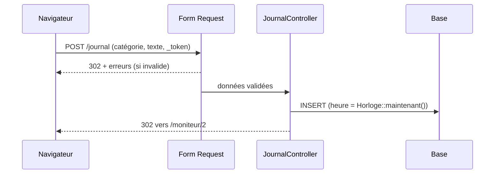

# Journal d'incident, formulaires et validation

> **Séance 3** · Lecture 9 min · ▶️ [Faire la séance](../seances/seance-03.md)

## L'idée

Le **journal d'incident** garde chaque fait, décision, action ou notification, **horodaté** et **signé**. Il sert
pendant l'incident (qu'a-t-on décidé pendant que j'étais au téléphone avec PilatPay ?) et après : rapport final à
l'ANSSI, informations aux clients, audit, voire un juge. Il n'a de valeur que si personne ne peut le réécrire : on
**ajoute**, on ne modifie jamais ; une erreur se corrige par une nouvelle entrée qui cite celle qu'elle corrige.

> ⚖️ Un écrit électronique a la même force probante qu'un écrit papier si l'on peut **identifier son auteur** et s'il
> est **conservé intègre** (code civil, art. 1366). Immuabilité (cette séance) et signature (séance 6) : les deux
> conditions → [le droit, § 6](../docs/cadre-juridique.md#6-le-contrat--gtr-pénalités-preuve).



## Le code à reconnaître

```php
public function store(EnregistrerEntreeRequest $request)
{
    Journal::create([...$request->validated(), 'heure' => Horloge::maintenant(), 'source' => 'centre']);
    return redirect()->route('moniteur.journal');
}
```
```php
protected static function booted(): void
{
    static::updating(fn () => throw new RegleNonRespectee('Une entrée du journal ne se modifie pas.'));
    static::deleting(fn () => throw new RegleNonRespectee('Une entrée du journal ne se supprime pas.'));
}
```

## Les pièges

- **Prendre l'heure dans le formulaire** : chacun taperait la sienne ; on ne pourrait plus ordonner les faits.
- **Oublier `@csrf`** : erreur 419.
- **Se contenter de supprimer les routes** : un autre code pourrait encore modifier une entrée. Le modèle refuse aussi.
- **`{!! $e->texte !!}`** : le texte saisi s'exécute dans la page de tout le centre (injection de script). Toujours `{{ }}`.

## ✅ Auto-évaluation

1. Qu'est-ce qu'une Form Request, et que reçoit le contrôleur ?
2. Contre quelle attaque protège le jeton CSRF ?
3. Pourquoi l'immuabilité est-elle garantie « deux fois » ?
4. Comment corrige-t-on une entrée erronée ?
5. À quelles conditions le journal peut-il servir de preuve ?

<details><summary>Réponses</summary>

1. Une classe de règles de validation ; le contrôleur ne reçoit que les champs validés (`$request->validated()`).
2. Un autre site qui ferait envoyer le formulaire à votre insu, avec votre session.
3. Aucune route ne modifie, et le modèle refuse `update` et `delete` : la règle tient même si une route est ajoutée par erreur.
4. On ajoute une entrée qui cite celle qu'elle corrige (`corrige_id`) ; l'erreur reste visible, barrée.
5. Si son auteur est identifié et s'il est conservé intègre (code civil, art. 1366).
</details>
