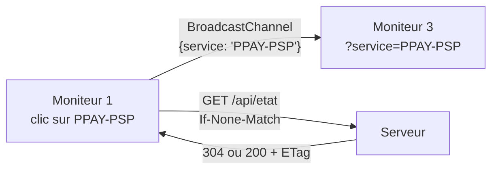

# API, ETag et communication entre fenêtres

> **Séance 5** · Lecture 8 min · ▶️ [Faire la séance](../seances/seance-05.md)

## L'idée

Recharger toute la page toutes les 5 secondes, c'est simple, mais ça clignote, ça efface une saisie en cours et ça
gaspille : la plupart du temps, rien n'a changé. Mieux : le moniteur demande à une **API** « quelle est la version de
l'état ? » ; le serveur répond avec une empreinte (**ETag**). Le moniteur la renvoie à chaque question
(`If-None-Match`) : si rien n'a changé, le serveur répond **304**, sans contenu. Sinon, le moniteur ne remplace que les
**zones vivantes** de sa page.

Les quatre moniteurs sont quatre fenêtres d'un même navigateur, sur le même poste : pour partager une sélection, un
**BroadcastChannel** suffit, sans passer par le serveur.



## Le code à reconnaître

```php
$etag = '"'.$version.'"';
if ($request->header('If-None-Match') === $etag) {
    return response('', 304)->header('ETag', $etag);
}
return response()->json([...])->header('ETag', $etag);
```
```js
const r = await fetch('/api/etat', { headers: etag ? { 'If-None-Match': etag } : {} });
if (r.status === 200) { etag = r.headers.get('ETag'); /* rafraîchir les zones */ }
```
```js
// remplacer seulement les zones vivantes, sans recharger la page
const html = await (await fetch(location.href)).text();
const page = new DOMParser().parseFromString(html, 'text/html');
const nouvelles = page.querySelectorAll('[data-zone-vivante]');
document.querySelectorAll('[data-zone-vivante]').forEach((zone, i) => zone.replaceWith(nouvelles[i]));
```
```js
const canal = new BroadcastChannel('centre-de-supervision');
canal.postMessage({ service: 'PPAY-PSP' });          // une fenêtre envoie
canal.onmessage = ({ data }) => { … };            // les autres reçoivent
```

## Les pièges

- **Une version qui change à chaque requête** (on y met `now()`) : toujours 200, on recharge tout comme avant.
- **Une version qui ne change jamais** (on oublie une table) : l'écran ne se met plus à jour.
- **Remplacer toute la page** : le formulaire du journal est effacé pendant qu'on écrit.
- **Oublier les guillemets de l'ETag** : la norme HTTP veut `"a1f…"`, avec les guillemets.

## ✅ Auto-évaluation

1. Que contient une réponse 304, et quand le serveur la renvoie-t-il ?
2. Quel en-tête le navigateur envoie-t-il pour dire « voici la version que je connais » ?
3. Pourquoi l'heure de l'exercice (en minutes) fait-elle partie de la version ?
4. Pourquoi un BroadcastChannel suffit-il pour partager la sélection entre les moniteurs ?
5. Que renvoie `/api/poste`, et à quoi cela sert-il ?

<details><summary>Réponses</summary>

1. Aucun contenu, juste le code (et l'ETag) : quand l'ETag envoyé par le navigateur correspond à l'état actuel.
2. `If-None-Match`.
3. Parce que les écrans affichent des durées qui dépendent de l'heure : quand elle avance, ils doivent se mettre à jour.
4. Les quatre fenêtres sont dans le même navigateur et sur le même site : le canal les relie directement.
5. La configuration du poste (quelle vue sur quel écran) avec l'adresse de chaque moniteur : le lanceur ouvre chaque fenêtre au bon endroit.
</details>
