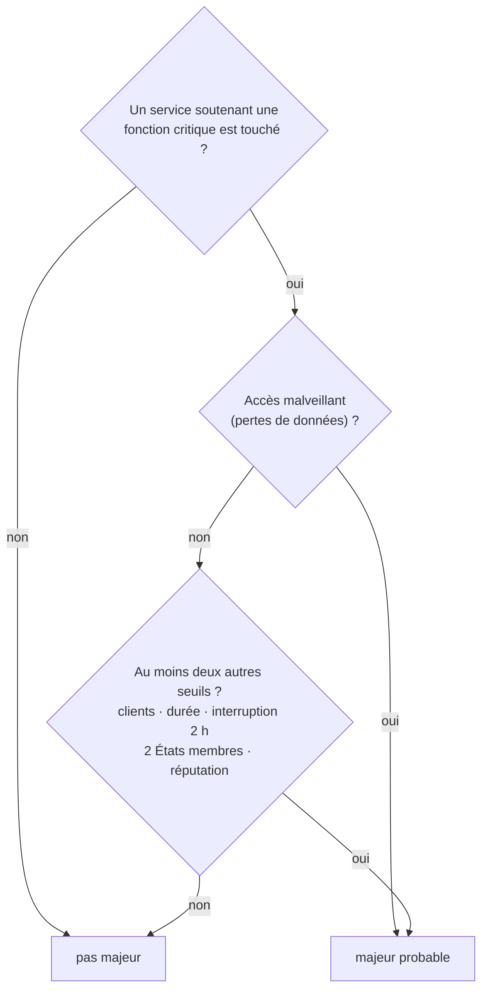

# DORA : classification, registre et indicateurs

> **Séance 7** · Lecture 10 min · ▶️ [Faire la séance](../seances/seance-07.md)

## L'idée

Le Crédit Furanais, PilatPay et la Mutuelle Forézienne sont des **entités financières** : DORA (règlement
2022/2554) leur impose de **classer** chaque incident lié aux TIC et, s'il est **majeur**, de le notifier à l'ACPR
— 4 h après l'avoir classé, au plus tard 24 h après en avoir eu connaissance. **C'est le client qui classe**, pas
Sevranne. Mais Sevranne, leur prestataire TIC, sait beaucoup de choses, et le contrat l'oblige à les lui donner.



Pour l'**interruption de plus de 2 heures**, il faut savoir combien de temps un service a été coupé, même s'il est
revenu : c'est l'**historique** de la séance 2. Chaque client tient aussi un **registre d'informations** de ses
contrats TIC, et surveille la **concentration** : trop de fonctions critiques chez un seul prestataire.

> ⚖️ Les seuils et les délais : [le droit, § 4](../docs/cadre-juridique.md#4-les-clients-financiers-au-regard-de-dora).

## Le code à reconnaître

```php
// la plus longue indisponibilité, d'après l'historique
foreach ($etats as $i => $h) {
    if ($h->etat === 'indisponible') {
        $fin = $etats[$i + 1]->debut ?? $maintenant;
        $plusLongue = max($plusLongue, (int) $h->debut->diffInMinutes($fin));
    }
}
```
```php
return $evaluation['critique']
    && (in_array('donnees', $evaluation['seuils'], true) || count(array_diff($evaluation['seuils'], ['donnees'])) >= 2);
```

## Les pièges

- **Prendre l'indisponibilité en cours** (`indisponible_depuis`) : un service revenu en mode dégradé n'en a plus ;
  la coupure de 2 h 17 a disparu. Il faut l'historique.
- **Compter les seuils sans vérifier les services critiques** : sans fonction critique touchée, rien n'est majeur.
- **Écrire « majeur »** : c'est le client qui décide ; Sevranne ignore, par exemple, l'impact économique.
- **Compter une dépendance redondante** dans la concentration : si le composant tombe, le service continue.
- **Recopier une règle dans un indicateur** : appelez `Indisponibilite::niveau()` et `Notifications::statut()`.

## ✅ Auto-évaluation

1. Qui classe un incident au sens de DORA, et qui notifie l'ACPR ?
2. PilatPay (France et Belgique), passerelle coupée depuis 09:18, à 10:00 : quels seuils ? Majeur probable ?
3. Pourquoi l'accès malveillant suffit-il à lui seul ?
4. Une coupure de 09:18 à 11:20, puis de 11:40 à 12:00 : plus longue indisponibilité ?
5. Qu'est-ce que le risque de concentration ?

<details><summary>Réponses</summary>

1. L'entité financière (le client) classe l'incident et le notifie à son autorité ; Sevranne lui fournit les éléments.
2. Clients (le service est coupé pour tous ses utilisateurs) et géographie (deux États membres) : deux seuils, service critique touché → majeur probable.
3. Le règlement délégué 2024/1772 (art. 8) en fait une condition suffisante : un accès malveillant pouvant entraîner des pertes de données, sur un service critique.
4. 2 h 02 (09:18 → 11:20).
5. Trop de fonctions critiques qui dépendent d'un même prestataire : une seule défaillance, et elles tombent toutes.
</details>
