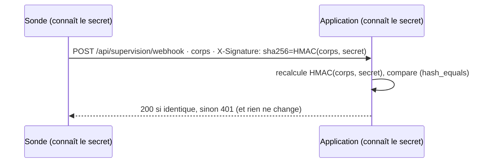

# Audit, signature HMAC et retour d'expérience

> **Séance 8** · Lecture 9 min · ▶️ [Faire la séance](../seances/seance-08.md)

## L'idée

Avant de mettre une application en service :
- on l'**audite** avec une grille (ici l'OWASP Top 10 2021) : pour chaque risque, où regarder, ce qu'on trouve, un verdict ;
- on **teste** ses règles avec des tests qui échouent quand on les casse ;
- on la prépare pour l'**exploitation** : configuration de production, sonde de santé, pages d'erreur sans détail ;
- on fait une **recette** : la demandeuse vérifie, sur un scénario connu, que le résultat est celui qu'elle attend.

Une application reçoit aussi des données **d'autres systèmes** : une sonde de supervision, un outil de tickets. Une
personne prouve qui elle est par sa session ; un programme, par une **signature** : il calcule une empreinte du message
avec un **secret partagé** (HMAC-SHA256) et l'envoie dans un en-tête. Le serveur refait le calcul : si l'empreinte
diffère, le message ne vient pas de la sonde, ou il a été modifié en route.



Un dispositif de supervision se **teste** comme un plan : on le joue (l'exercice), puis on écrit le **retour
d'expérience** : ce qui a tenu, ce qui n'a pas tenu, ce que l'on change — dans l'outil, mais surtout dans les
contrats, les procédures, l'organisation.

> ⚖️ NIS 2 demande d'évaluer l'efficacité des mesures (art. 21.2 f) et de sécuriser la chaîne d'approvisionnement
> (art. 21.2 d) ; le rapport final à l'ANSSI dit la cause profonde → [le droit, § 3](../docs/cadre-juridique.md#3-quand-un-incident-est-il--important--et-que-faut-il-notifier--nis-2).

## Le code à reconnaître

```bash
php artisan route:list -v              # chaque route et ses middlewares : qui est ouvert à tous ?
```
```php
$attendue = 'sha256='.hash_hmac('sha256', $request->getContent(), $secret);
if ($secret === '' || ! hash_equals($attendue, (string) $request->header('X-Signature'))) {
    abort(401);
}
```

## Les pièges

- **Croire que la séance 6 a tout protégé** : `routes/api.php` n'est pas dans le groupe `auth` de `routes/web.php`.
- **Comparer avec `===`** : la comparaison s'arrête au premier caractère différent ; mesurer le temps de réponse aide à deviner la signature. `hash_equals` compare en temps constant.
- **Accepter un secret vide** : `hash_hmac` avec une clé vide se calcule très bien… par n'importe qui.
- **Un test qui passe même quand on casse la règle** : il ne protège rien.
- **`APP_DEBUG=true` en production** : la moindre erreur affiche le code et la configuration.

## ✅ Auto-évaluation

1. Pourquoi `route:list -v` est-il le premier outil de l'audit du contrôle d'accès ?
2. Que prouve une signature HMAC valide ? Que ne prouve-t-elle pas ?
3. Pourquoi `hash_equals` et pas `===` ?
4. Comment sait-on qu'un test protège vraiment une règle ?
5. Que doit contenir — et ne pas contenir — une sonde de santé ?

<details><summary>Réponses</summary>

1. Il montre chaque route avec ses middlewares : une route sans `auth` (ni autre protection) saute aux yeux.
2. Que le message vient de quelqu'un qui connaît le secret et qu'il n'a pas été modifié ; pas que son contenu est vrai (la sonde peut se tromper).
3. Pour comparer en temps constant : le temps de réponse ne révèle rien de la signature attendue.
4. On casse la règle exprès : le test doit passer au rouge.
5. Si l'application et sa base répondent (et l'heure) ; aucune donnée métier, rien sur les clients.
</details>
