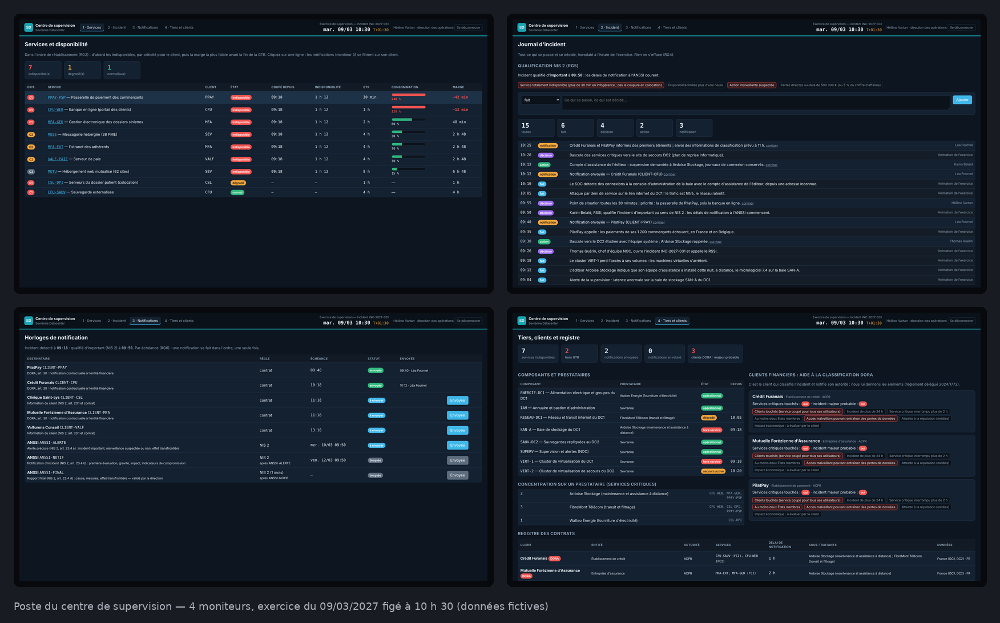

# Maquettes — ce que vous allez construire

Captures de l'application **terminée** (corrigé), pendant l'exercice du mardi 9 mars 2027 figé à **10 h 30**. Le centre
a déjà prévenu PilatPay (09:40) et le Crédit Furanais (10:12), et écrit quatre entrées au journal. C'est un site web :
une page par moniteur, ouverte dans le navigateur de chaque écran.

| Moniteur | Adresse | Ce qu'on y voit à 10 h 30 |
|---|---|---|
| [1 · Services et disponibilité](moniteur-1-services.png) | `/moniteur/1` | 7 services indisponibles depuis 09:18, dans l'ordre de rétablissement ; la passerelle de PilatPay en tête, **240 %** de sa GTR de 30 min consommée (hors GTR, marge −42 min), puis la banque en ligne à 120 % ; le dossier patient de la clinique dégradé |
| [2 · Incident et qualification](moniteur-2-incident.png) | `/moniteur/2` | incident qualifié d'important à **09:50** ; deux critères NIS 2 atteints (service totalement indisponible, malveillance suspectée) ; le journal, faits du scénario et entrées du centre, signées, le plus récent en haut |
| [3 · Horloges de notification](moniteur-3-notifications.png) | `/moniteur/3` | PilatPay et le Crédit Furanais prévenus dans les délais ; l'alerte précoce ANSSI à envoyer avant le **mercredi 10/03 à 09:50** ; la notification et le rapport final bloqués tant que l'étape précédente n'est pas faite ; [filtré sur PPAY-PSP](moniteur-3-selection-ppay.png) après un clic sur le moniteur 1 |
| [4 · Tiers, clients et registre](moniteur-4-tiers.png) | `/moniteur/4` | les indicateurs ; la baie SAN-A (Ardoise Stockage) hors service, le secours du DC2 activé à 10:20 ; pour chaque client financier, les seuils DORA atteints et « incident majeur probable » ; la concentration sur Ardoise Stockage et FibreMont (3 services critiques chacun) ; le registre des contrats |

Également : la [fiche d'un service](fiche-service-ppay.png) et l'[impact d'un composant](impact-san-a.png) (séance 2),
et la [page de connexion](connexion.png) (séance 6).

Au premier jour, seul un moniteur 1 rudimentaire existe : c'est vous qui construisez le reste, séance après séance.
