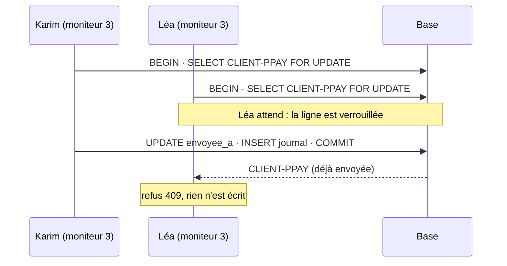

# 4️⃣ Séance 4 — Incident important (NIS 2) et moniteur 3 : les notifications

> **Durée** 2 h · **Tests** `php artisan test --group=seance-04` · **Fiche de cours** [Incident important, notifications, transaction](../cours/04-nis2-notifications-transaction.md)

## 🧭 Feuille de route

> 🎯 **Pourquoi cette séance ?** Le jour de l'incident, personne n'a su dire s'il fallait prévenir l'ANSSI, ni avant quand. PilatPay, dont le contrat prévoit une notification dans les 30 minutes, l'a appris en appelant lui-même. Le moniteur 2 doit dire si l'incident est **important** au sens de NIS 2 ; le moniteur 3 doit tenir les **horloges** : qui prévenir, avant quand, dans quel ordre, et une seule fois.
> **Pour le métier :** traduire un texte réglementaire en règles exactes ; refuser proprement (le bon code HTTP, un message lisible) ; faire une modification **en entier ou pas du tout**, même quand deux personnes cliquent ensemble.
>
> **À la fin, vous saurez :** traduire des critères réglementaires en code · calculer des échéances qui dépendent d'événements · refuser avec une exception métier et un code 409 · protéger une modification par une transaction et un verrou
>
> ⚖️ **Le droit derrière la séance :** NIS 2, art. 23 : **alerte précoce sous 24 h**, **notification sous 72 h**, **rapport final sous un mois**, à compter de la prise de connaissance de l'incident important ; les critères sont ceux du règlement d'exécution 2024/2690. Et chaque contrat client fixe son propre délai → [§ 3](../docs/cadre-juridique.md#3-quand-un-incident-est-il--important--et-que-faut-il-notifier--nis-2), [§ 4](../docs/cadre-juridique.md#4-les-clients-financiers-au-regard-de-dora).

### 📖 À lire — on lit, on ne produit rien

| Quand | Quoi | Temps |
|---|---|---|
| **avant** la séance | la fiche [Incident important, notifications, transaction](../cours/04-nis2-notifications-transaction.md), puis son auto-évaluation | 10 min |
| au début | [la situation](#-la-situation) ; RG5, RG6 et la section 6 du [cahier des charges](../docs/cahier-des-charges.md) ; le § 3 du [droit](../docs/cadre-juridique.md) | 8 min |
| avant de modifier | le code existant : `app/Models/Notification.php`, `app/Regles/Nis2.php` et `app/Regles/Notifications.php` (les signatures), `app/Regles/RegleNonRespectee.php` | 10 min |

### ✏️ À faire — chaque ligne laisse une trace que l'on peut vérifier

*Chemins depuis `projetLaravel/` · 🆕 fichier à créer · 🟢 guidé · 🟡 semi-guidé · 🔴 facultatif.*

| Mission | | Vous produisez | Où | Preuve |
|---|---|---|---|---|
| 2 · Comprendre | 🟢 | 5 réponses écrites, dont trois calculs d'échéance | `CARNET.md` | interrogation n° 1 |
| 4.1 | 🟢 | RG5 : les critères NIS 2 ; RG6 : échéance, prérequis, statut ; les critères au moniteur 2 | `app/Regles/Nis2.php`, `app/Regles/Notifications.php`, le moniteur 2 | tests `m1` |
| 4.2 | 🟢 | le moniteur 3 et le bouton « Envoyée » | `Notifications::envoyer()`, `app/Http/Controllers/NotificationsController.php` 🆕, une vue 🆕, deux routes | tests `m2` |
| 4.3 | 🟡 | les refus : 409 avec un message, 404 | le contrôleur | tests `m3` |
| 4.4 | 🟡 | tout ou rien : transaction et verrou | `Notifications::envoyer()` | tests `m4` |
| 4.5 | 🔴 | les notifications en JSON : `GET /api/notifications` | le contrôleur, une route | bonus `s4_m5` |
| **Fin** | ✅ | commit + push · cases cochées · journal au portail | dépôt, portail | onglet *Actions* vert |

### 🧠 À retenir — interrogé dans l'interrogation n° 1 (début de la séance 5)

**Incident important (NIS 2)** · **Alerte précoce et notification** · **Code 409** · **Transaction** · **Verrou (`lockForUpdate`)** — définitions en [fin de séance](#-à-retenir).

---

## 📖 La situation

> **De :** Karim Belaïd, RSSI
> **Copie :** Hélène Vartan
> **Objet :** NIS 2 : qualifier, puis notifier à l'heure
>
> Bonjour,
> Nous sommes une **entité importante** au sens de NIS 2. Quand un incident atteint un des critères du règlement
> 2024/2690, il est **important** : nous devons alerter l'ANSSI dans les **24 heures**, lui notifier l'incident dans
> les **72 heures**, et lui remettre un **rapport final** un mois après. Le deuxième écran doit me dire quels critères
> sont atteints. C'est moi qui qualifie l'incident : à partir de là, les horloges tournent.
> Le troisième écran, ce sont ces horloges, plus celles de nos clients : chaque contrat fixe un délai pour les
> prévenir, à partir de la détection (30 minutes pour PilatPay). Par échéance, avec ce qui est envoyé, proche, en
> retard. On n'envoie pas la notification avant l'alerte précoce, ni le rapport final avant la notification. Et une
> notification ne part **qu'une fois**, même si deux personnes cliquent ensemble.

Ce sont les règles **RG5** et **RG6** du [cahier des charges](../docs/cahier-des-charges.md).

---

## 1 ▶️ Lancer

```bash
./lancer.sh recette
php artisan tinker
>>> App\Models\Exercice::courant()->only('detecte_a', 'important_depuis', 'malveillance_a')
>>> App\Models\Notification::with('dependDe')->get()->map(fn ($n) => [$n->code, $n->regle, $n->delai_minutes, $n->dependDe?->code])
```

## 2 🔍 Comprendre

> ✏️ Répondez dans [`CARNET.md`](../CARNET.md), section *Séance 4*.

1. ⚖️ La passerelle de PilatPay (infogérance) est totalement coupée depuis 09:18. À 09:48 pile, l'incident est-il important ? À 09:49 ? Et si c'était un service de colocation ?
2. ⚖️ Le RSSI qualifie l'incident à 09:50. Échéances de l'alerte précoce et de la notification à l'ANSSI ? Pourquoi ne partent-elles pas de 09:18 ?
3. L'incident est détecté à 09:18 ; le contrat de PilatPay prévoit 30 minutes. Échéance ? À partir de quelle heure le statut est-il « proche » ?
4. On demande d'envoyer la notification ANSSI alors que l'alerte précoce n'est pas partie. Quel code HTTP, et pourquoi pas 400 ni 404 ?
5. La notification est marquée « envoyée », puis l'écriture au journal échoue (disque plein). Qu'a-t-on perdu ?



## 3 ✏️ Modifier

### Mission 4.1 🟢 — RG5 : qualifier ; RG6 : compter

**Attendu :**
- `Nis2::seuilPertes($ca)` : le plus bas de 500 000 € et 5 % du chiffre d'affaires ;
- `Nis2::criteres($exercice, $services, $maintenant)` : la liste des critères atteints, dans l'ordre de
  `Nis2::CRITERES` — `indisponibilite_totale` (un service d'infogérance indisponible **plus de** 30 min, ou un service
  de colocation indisponible), `disponibilite_limitee` (un service dégradé **plus d'**une heure : `etat_depuis`),
  `malveillance` (`malveillance_a` passée), `pertes` (`pertes_estimees` au-dessus du seuil ; le chiffre d'affaires est
  dans `config('exercice.organisation.chiffre_affaires')`) ;
- `Notifications::echeance($n, $exercice)` : règle `nis2` → `important_depuis` + délai ; `nis2_final` → un mois après
  l'envoi de celle dont elle dépend (`addMonth()`) ; `contrat` → `detecte_a` + délai ; `null` si le point de départ
  n'existe pas encore ;
- `Notifications::peutEtreEnvoyee($n)` : vrai si elle ne dépend de rien, ou si celle dont elle dépend est envoyée ;
- `Notifications::statut()` : `envoyee`, sinon `en_retard` **au-delà** de l'échéance (même bloquée : le retard prime),
  sinon `bloquee`, sinon `en_attente` (pas d'échéance), sinon `proche` (il reste un quart du délai ou moins), sinon
  `a_envoyer` ;
- le moniteur 2 affiche chaque critère (`data-critere="malveillance" data-atteint="1"`) et l'heure de qualification
  (`data-important-depuis="09:50"`).

```php
public static function echeance(Notification $notification, Exercice $exercice): ?CarbonImmutable
{
    return match ($notification->regle) {
        'nis2' => $exercice->important_depuis?->addMinutes($notification->delai_minutes),
        'nis2_final' => $notification->dependDe?->envoyee_a?->addMonth(),
        default => $exercice->detecte_a?->addMinutes($notification->delai_minutes ?? 0),
    };
}
```

`criteres()` et `statut()` sont à vous : suivez l'énoncé, dans l'ordre.

✅ `php artisan test --filter=test_m1 --group=seance-04`

### Mission 4.2 🟢 — Moniteur 3 : envoyer une notification

**Attendu :**
- `/moniteur/3` (route `moniteur.notifications`) liste les notifications **par échéance** (celles sans échéance à la
  fin), puis par code : `<tr data-notification="CLIENT-PPAY" data-statut="en_retard">`, avec l'échéance (`11:18`,
  ou `mer. 10/03 09:50` si ce n'est pas aujourd'hui) ;
- un bouton « Envoyée » fait `POST /notifications/CLIENT-PPAY/envoyee` (route `notifications.envoyee`) avec un champ
  `auteur` : la notification est datée et signée, le journal reçoit une entrée `notification`
  « Notification envoyée — PilatPay (CLIENT-PPAY) » ; on revient au moniteur 3.

```php
Route::get('/moniteur/3', [NotificationsController::class, 'index'])->name('moniteur.notifications');
Route::post('/notifications/{notification}/envoyee', [NotificationsController::class, 'envoyee'])->name('notifications.envoyee');
```

`{notification}` : le modèle `Notification` se cherche par son **code** (`getRouteKeyName()`), et répond 404 s'il
n'existe pas.

✅ `php artisan test --filter=test_m2 --group=seance-04`

### Mission 4.3 🟡 — Les refus

**Attendu :** déjà envoyée, ou prérequis pas envoyé : **409**, avec un message qui dit pourquoi (pour un prérequis, il
cite son code) ; rien n'est écrit. Une notification inconnue : 404.

> 💡 **Indice.** `try { … } catch (RegleNonRespectee $e) { abort(409, $e->getMessage()); }` : pour un appel qui
> demande du JSON, Laravel répond `{"message": "…"}` ; pour une page, la page d'erreur 409.

✅ `php artisan test --filter=test_m3 --group=seance-04`

### Mission 4.4 🟡 — Tout ou rien : la transaction

**Attendu :** si l'écriture au journal échoue, la notification **n'est pas** marquée envoyée ; deux clics simultanés
ne produisent qu'une entrée.

1. Enveloppez tout `envoyer()` dans `DB::transaction(function () use (…) { … });`.
2. Au début de la transaction, **relisez** la notification sous verrou :
   `$n = Notification::whereKey($notification->id)->lockForUpdate()->firstOrFail();`.

✅ `php artisan test --filter=test_m4 --group=seance-04`

### Mission 4.5 🔴 — Les notifications en JSON

**Attendu :** `GET /api/notifications` renvoie `[{code, destinataire, statut, echeance}]` (échéance
`2027-03-09 09:48`), dans l'ordre du moniteur 3 — l'outil de tickets de l'exploitation s'y branchera.
*(test : `php artisan test --filter=s4_m5`)*

## 4 ✅ Valider

```bash
php artisan test --group=seance-04
php artisan test --group=socle
git add -A
git commit -m "feat: incident important (RG5), moniteur 3, notifications (RG6), refus 409, transaction"
git push
```

**Annonce :** l'interrogation n° 1 (séances 1 à 4) ouvre la séance 5 : 30 minutes, sur papier.

---

## 🧠 À retenir

*Ce sont les cinq points de l'interrogation n° 1.*

1. **Incident important (NIS 2)** — un incident qui atteint au moins un critère du règlement d'exécution 2024/2690 (indisponibilité, malveillance, pertes…) : il se notifie à l'ANSSI.
2. **Alerte précoce et notification** — 24 h puis 72 h après la prise de connaissance de l'incident important ; le rapport final un mois après la notification.
3. **Code 409** — *Conflict* : la demande est bien formée mais contredit l'état actuel (déjà envoyée, prérequis manquant). 404 : la ressource n'existe pas.
4. **Transaction** — un groupe d'écritures qui réussit en entier ou est annulé en entier (`DB::transaction`).
5. **Verrou (`lockForUpdate`)** — relire une ligne en la verrouillant : une autre transaction qui veut la même ligne attend la fin de la première.

## ✏️ Journal de fin de séance (portail)

Ce que j'ai fait · ce qui m'a bloqué · ce que j'ai compris aujourd'hui.
